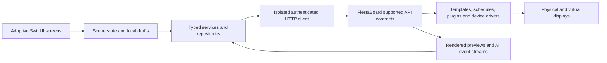

# FiestaBoard iOS design

**Status:** Approved by the user on October 25, 2026. Contract-foundation work has started; full first-release parity and all useful device poses remain required.

Build `fiestaboard-ios` as a native SwiftUI controller for an existing FiestaBoard server. First App Store release must cover the complete web app, including advanced administration. Milestones are development checkpoints, not permission to ship a reduced feature set.

## Product and architecture decisions

Use one universal iOS/iPadOS app, Swift 6 strict concurrency, SwiftUI, Observation, URLSession and local Swift packages. Propose iOS/iPadOS **26.0 minimum**, built using **Xcode/iOS SDK 27.1 or later**; guard newer APIs. This provides native glass while supporting the preceding OS generation. No macOS/tvOS target is added here.

Keep scheduling, plugin execution, secrets for integrations, template evaluation, canvas rasterization and device communication on the FiestaBoard server. The app owns interaction, local drafts, session credentials, previews and presentation state. Remote access uses an existing operator-provided HTTPS endpoint or VPN; this project does not create a relay/cloud service.

Considered alternatives: a WebView wrapper is cheaper initially but does not meet the requested native interaction/design; recreating the server on-device would duplicate plugin/runtime behavior. A native client sharing server behavior is the recommended approach. A UIKit-only app offers more manual control but increases layout work; use UIKit selectively for rich text inside SwiftUI.

## Native UI

Use a common route/selection model with adaptive system tabs/sidebar and split navigation. Compact primary destinations: Home, Library, Schedule, Displays, More. Library contains Pages, Collections and Picks. More exposes Integrations, Settings, Account, Diagnostics and help. Expanded navigation exposes those destinations directly. AI remains reachable from the toolbar and editor. Display selection and server identity remain visible where actions depend on them.

The native design preserves FiestaBoard branding, board colors and output fidelity. Use SF Symbols, semantic colors, Dynamic Type and standard sheets, menus and forms. Liquid Glass belongs to navigation, toolbars and a small number of floating controls; previews, dense forms and canvas content use readable surfaces. Support light/dark, increased contrast, reduced transparency and reduced motion. This follows [Apple's materials guidance](https://developer.apple.com/design/human-interface-guidelines/materials).

| Available space or pose | Intended behavior |
|---|---|
| Narrow iPhone / Duo closed / narrow split window | One navigation stack, readable cards, compact preview, editor tools in native sheets; no compressed desktop form. |
| Duo open / wider window | List-detail navigation; editor and preview side by side only when both have usable width. |
| Seated or partially folded | Where system geometry/reserved regions support it, preview above and editing controls below; keep important controls clear of the fold/system region. No invented hinge thresholds. |
| Standing/tent or short wide region | Readable current-board monitoring and quick controls; retain access to full editing through adaptive navigation. No automatic command or mode change solely because of pose. |
| iPad expanded / resizable window | Sidebar, content and optional inspector; pointer, keyboard shortcuts, drag/drop and Pencil canvas input where available. |

Use current container dimensions, content requirements and safe areas, not device-name checks, `UIScreen.main.bounds`, fixed orientations or assumptions that regular width means iPad. Support asymmetric leading/trailing safe areas and vertical system bars. Preserve route, selected board/page, editor selection, draft, undo history and presentation intent through resizing/folding. Multiwindow state is scene-local; saved content and sessions are shared through repositories, with conflict handling. [Apple Duo guidance](https://developer.apple.com/iphone-duo/prepare/) defines the SDK and resizing baseline.

## Full release parity

Freeze the release reference to a clean, merged FiestaBoard version during milestone 0. Committed v10 is the initial audit baseline. Current uncommitted UX refresh is a design reference, not a released contract. Maintain a signed-off matrix of every route, visible action, payload, permission, state and test. Full parity means equivalent capability and preserved data, not identical web widgets. Any omission requires an explicit user scope change.

| Area | Required native workflows |
|---|---|
| Connection/onboarding | Bonjour discovery/manual URL, server selection, fresh-server setup, authentication enabled/disabled/undecided, logout/relogin, offline recovery, capability errors. |
| Home/control | Actual output, selected/scheduled content, service state, quick send, pause/resume, silence/overrides, temporary/held output, refresh, restore schedule, explicit target display. |
| Displays/panels | List/add/remove, marketplace and Git install, setup/discovery/test/actions, output schemas, geometry/calibration, connection settings, playback/transitions/silence; standalone panel-viewer equivalents and sharing. |
| Pages/Picks | Search/filter/grid/list, all page types, CRUD/duplicate/import/export/share, compatibility, previews, active selection, staff picks and demos. |
| Editor | Rich/plain text, tokens/variables/formulas/colors/icons/metadata, target geometry/charset, cell painting, undo/redo, live preview, explicit live-to-board mode, drafts and navigation protection, AI changes. |
| Canvases | Draw/Shapes/Source, up to eight canvases, areas/bleed/scale/flow, palettes/pixels and dynamic expressions, server-rasterized layers, warnings and explicit field clearing. |
| Collections | CRUD, order, rule modes, random/time/variable behavior, per-page duration, defaults and preview/current resolution. |
| Schedules | CRUD/toggle, calendar and list, drag/time resize plus accessible form alternative, recurrence/annual/one-off, sun events/offsets, timezones/DST, gaps/conflicts, defaults and per-display behavior. |
| Integrations | Installed/marketplace/Git, install/update/remove, enable, schema settings including remote options/secret preservation, instances, variables, demos and provenance. OAuth relay/device/key_exchange/plex_pin, manual code/URL paste, headless completion, app-registration fields, reconnect/disconnect, expiry and denial, including AI-provider connections. |
| AI | Provider configuration, global/editor conversations, streaming/tool events/questions/cancel, history, approvals where web behavior requires them, editor staging and save semantics. |
| Settings/account/admin | All web appearance/language/accessibility options or native equivalents, time/location/MQTT/MCP/AI, account credentials and sessions/device approvals, Wi-Fi when supported, backup/restore, updates/rollback, restart/shutdown and diagnostics/logs/cache/tests. |
| Cross-cutting | Fourteen existing locales, accessible focus/labels, deep links, sharing/import/export, recovery from partial failures and capability-gated controls. |

Platform-specific items such as PWA installation map to native installation/lifecycle; browser URL navigation maps to routes/deep links. Record each equivalence, rather than silently omitting it. OAuth and help may open secure browser sessions; core app screens are native. Capability-gated server features stay available when supported, with a clear reason when unavailable.

## Server and authentication contracts

The public `/api/v1` contract covers much of control and CRUD. Rich previews, live rendering, administration, AI and marketplace workflows still need internal endpoints. `/api/internal/openapi.json` explicitly offers no compatibility guarantee. Therefore **a supported first-party mobile API contract is a release gate**: reuse public v1 operations and use version-bounded first-party adapters for required internal operations, with automated compatibility tests. The implementation decision and acceptance rules are in [Mobile API compatibility](../../contracts.md). Do not simply generate a client from all internal routes and assume it is supported.

Milestone 0 produces an exact endpoint ledger and supported server version matrix. Proposed initial floor is v10.0.0 for validated operations, with an explicit newer minimum if required contracts land later. Do not advertise v9 support from the local 9.14.9 probe. Unknown server versions receive read-only capabilities that are verified and a clear upgrade/compatibility message before unsupported writes.

Use typed domain protocols and a transport boundary. Keep explicit request DTOs separate from tolerant response models; preserve unknown editable document fields in round trips and distinguish omitted values from explicit null. Pin public and selected internal schema snapshots to source commits. Generated public DTOs may be used behind adapters after a small compatibility spike; hand-written Codable DTOs are the default so domain/UI never depends on generated names.

Cookie-first authentication uses existing `/auth/login` and revocable sessions. Store session material in Keychain, never passwords, with a separate URLSession/cookie context per normalized deployment identity (scheme, host, port, base path). Never use the TV client ID or its limited bearer token. Never expose operator/MCP secrets as a shortcut. Enforce cookie Secure/path/domain semantics and prevent credential-bearing cross-origin or cross-deployment redirects. Logout revokes server session when reachable and always clears local credentials. Offline revocation remains explicitly pending, not claimed complete.

Preserve deployment prefixes in every URL, including preview images, OAuth and streaming. Session-admin mutations fetch CSRF context and supply the configured portal Origin; test trusted reverse-proxy behavior. Home Assistant ingress adds a separate upstream authentication layer: preserving its path is insufficient. Milestone 0 must validate an authorized native access route or a supported upstream browser-auth bridge; it may not silently declare ingress parity solved by URL joining.

Bonjour uses the actual advertised service definition from server/TV code and a user-initiated connection flow. Add local-network usage text and service declarations; handle denied permission, no results, changing addresses, IPv4/IPv6 and manual fallback. Permit HTTP only for deliberately selected local installations, with clear transport status; require HTTPS for internet endpoints. Use narrow ATS configuration and normal certificate validation. [Apple local-network guidance](https://developer.apple.com/documentation/technotes/tn3179-understanding-local-network-privacy) and [ATS guidance](https://developer.apple.com/documentation/bundleresources/information-property-list/nsapptransportsecurity/nsallowslocalnetworking) require device testing, not only simulator success.

## State and command semantics

Repositories key cache entries by server, board and resource. Scene stores own navigation/drafts; app/session services own transport. Poll only visible state at server-defined cadence with bounded concurrency, cancellation and backoff. Pause foreground polling in background; refresh on return. Ordinary board state is polling, not a presumed WebSocket service. AI uses POST SSE with incremental parsing and cancellation.

Use a single mutation coordinator per resource: serialize writes, update after confirmation, invalidate affected reads and refresh actual state. Never automatically replay send, restart, install, restore or AI tool streams after ambiguous timeout. Distinguish not-sent, rejected, acknowledged and outcome-unknown. A successful selection save is not proof of physical display output. Keep actual output, selected page, schedule, pause, silence and held output separate in the UI.

Editor preview is side-effect free. Live-to-board is an explicit mode naming the target, showing active status and expiring safely. Tag render requests with draft revision/target, cancel superseded requests and ignore late responses. Save preserves unsupported fields or blocks unsafe edits. Add atomic revision validation in the shared server persistence layer before claiming stale-save protection. Every writer, including web, AI tools, imports and legacy routes, must advance the revision. Native and participating first-party web/editor/AI saves carry a precondition; explicit force/replacement operations have separate semantics. A legacy unconditional write can still overwrite newer content: record that limitation and reconcile it in the UI, rather than claiming universal overwrite prevention. Test both save orders. A client pre-save read alone cannot make a write atomic. Offer reload, duplicate or deliberate conflict resolution.

Use a document model plus TextKit-backed rich editor, with native plain mode. Do not reimplement template evaluation or rasterization. Use shared golden fixtures for split-flap, Note/arrays, arbitrary panel grids, LED case/icons/layers and white-board color behavior. Reuse TV render/model pieces only after reviewing their assumptions. Renderer work must prove correct data before animation polish.

Before broad editor/canvas implementation, prove the TextKit/document boundary in a bounded milestone-2 prototype using both existing editor families. Exercise token-adjacent edits, multiline paste, input-method composition, undo/redo, rich/plain switching and resizing. Canonical round trips and unknown-node preservation must pass before committing the remaining editor work to that approach.

OAuth orchestration stays on the server. Each of the four existing flows needs its own native start/completion/status contract; browser return is not universally an app callback. Prove manual paste and polling completion, local and prefixed return URLs, suspension/resume and interrupted/expired authorization without duplicate enrollment before advertising parity.

## Quality and release

The release gate is the complete parity matrix, passing contract and behavior tests, visual/accessibility review on compact/expanded/resized/folded/seated layouts, and real-device networking. Target 60 Hz interaction on the minimum test device, no work proportional to every offscreen animated thumbnail, and no accumulating polling tasks. Measure traces before setting tighter budgets.

Use unit/fixture tests for documents, schemas, parsing, state and geometry; integration tests against isolated pinned servers; UI tests for workflows, resizing and focus. Include VoiceOver, largest Dynamic Type, Reduce Motion/Transparency, increased contrast, keyboard, Pencil, light/dark and long translated strings. Performance and battery checks cover large libraries, streaming and canvas previews. Do not mutate the user's production board during automated testing.

App Store work includes signing/bundle identity, privacy manifest and data disclosures, icons, screenshots for device families/Duo poses, support/privacy URLs, licensing, export compliance answers based on actual dependencies, TestFlight feedback, release notes, and review access. Provide a maintained review server with virtual displays and a physical-device hardware demonstration video; optional demo mode must exercise full workflows with honest simulated outcomes. Follow [Apple's review access requirements](https://developer.apple.com/help/app-review/before-submitting-for-review/complete-review/). Server-side plugin installation stays server-side; do not download executable native code into the app.

## Execution and remaining product inputs

GPT-6.1 Sol agents implement bounded tasks with explicit ownership and tests; GPT-6 Astra reviews architecture/contracts, high-risk editor/auth work and each integrated milestone, then the complete release. Sol fixes findings; Astra rechecks substantive fixes. Review is a gate with evidence, not a promise that model choice guarantees quality. Run at most two implementers at once after shared interfaces settle; keep one reviewer/integrator slot.

Approved defaults: iOS 26 minimum, operator-provided remote connectivity, and a single universal app. Later release setup needs Apple team/bundle identifier, App Store ownership/branding and pricing. These do not block initial technical validation. App Store submission remains a separate release action.
